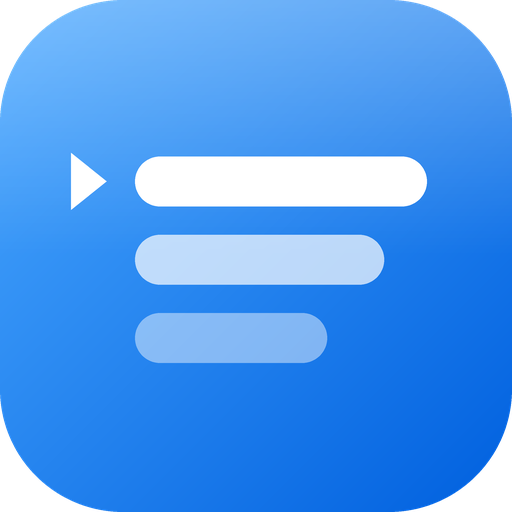
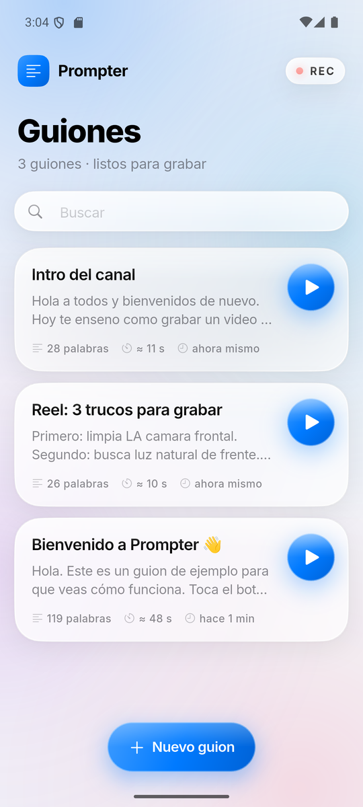
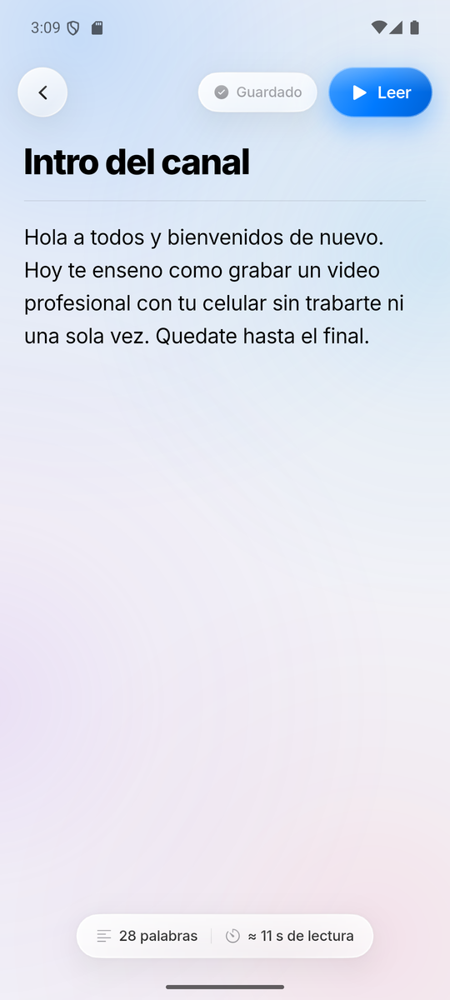
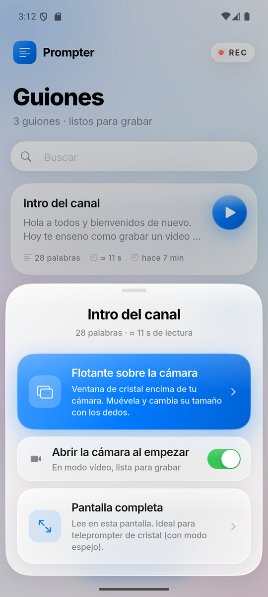
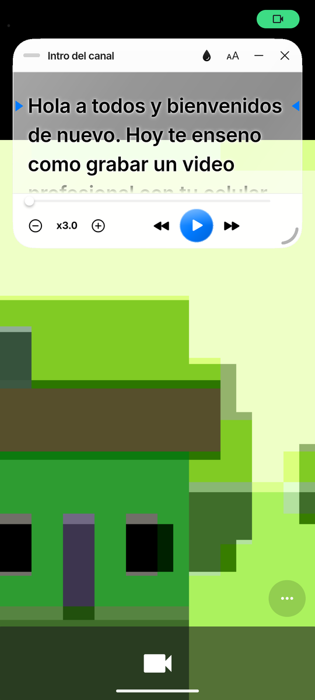
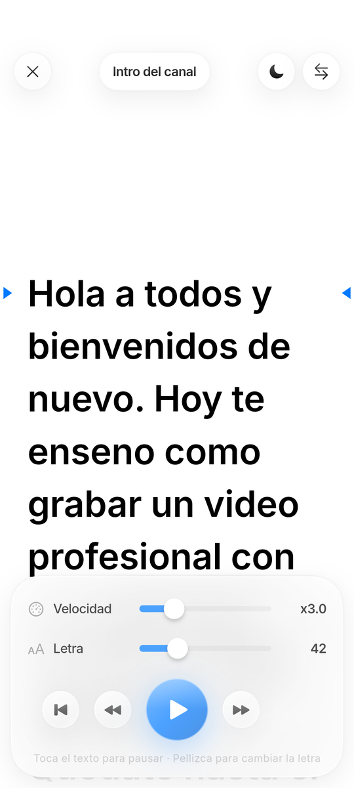

<div align="center">



# Prompter

**El teleprompter flotante para grabarte con la cámara frontal.**
Escribe tu guion, ábrelo en una ventana de cristal encima de tu cámara y léelo mirando a la lente.


</div>

---

<p align="center">
  
  
  
  
  
</p>

## ¿Por qué Prompter?

Grabar un vídeo hablando a cámara es fácil… hasta que se te olvida qué ibas a decir. Las apps de teleprompter suelen obligarte a grabar **dentro** de ellas, con su cámara y sus límites. Prompter hace lo contrario: **flota encima de la app de cámara que ya usas** (la de tu móvil, Instagram, TikTok, CapCut…) para que grabes con la calidad de siempre mientras lees tu guion.

## Lo que puedes hacer

### ✍️ Guiones con título y contenido
- Crea, edita, duplica y elimina guiones (desliza para borrar, con opción de deshacer).
- **Se guardan solos** mientras escribes.
- Cuenta de palabras y **tiempo estimado de lectura** (150 palabras por minuto).
- Buscador cuando tienes muchos guiones.

### 🪟 Ventana flotante sobre la cámara (Android)
- Una **ventana de cristal** que se queda encima de cualquier app.
- **Muévela** arrastrando la barra superior.
- **Cambia su tamaño con los dedos**: pellizca para agrandarla o achicarla (separa los dedos en horizontal para hacerla más ancha y en vertical para hacerla más alta) o arrastra la esquina inferior derecha.
- **Opacidad a tu gusto** con el botón de la gota, de sólida a totalmente transparente. El texto pasa solo de negro a blanco con sombra para que siempre se lea sobre la imagen de la cámara.
- **Controles siempre a mano**, sin entrar en ajustes:
  - ▶️ / ⏸ reproducir y pausar
  - ⏪ ⏩ retroceder y adelantar
  - ➖ ➕ velocidad más lenta o más rápida
  - barra de progreso que puedes arrastrar para saltar a cualquier parte
- Minimízala a una **burbuja** y tócala para recuperarla.
- Abre la **cámara en modo vídeo** automáticamente al empezar (pidiendo la frontal cuando el fabricante lo permite).
- Recuerda posición, tamaño y ajustes para la próxima vez.

### 📺 Pantalla completa
- Lector grande con **fondo blanco o negro**.
- **Modo espejo** para teleprompters de cristal.
- Pellizca para cambiar el tamaño de la letra.
- La pantalla no se apaga mientras lees.

### 🎬 Pensado para grabar
- Cuenta atrás **3 · 2 · 1** antes de empezar.
- **Línea de lectura** marcada y bordes difuminados para no perderte.
- Toca el texto para pausar; arrástralo para moverte a mano.

## Diseño

Interfaz inspirada en iOS y su estilo **Liquid Glass**: fondo claro con manchas de color suaves, paneles de cristal esmerilado con desenfoque, borde especular y sombras ligeras, esquinas *squircle*, botones que rebotan al pulsar, vibración sutil, iconos Cupertino, el azul de sistema de Apple (`#007AFF`) y tipografía [Inter](https://rsms.me/inter/), la más cercana a SF Pro con licencia libre.

## Instalación

### Descargar el APK
Ve a [**Releases**](../../releases) y descarga `prompter.apk` en tu Android. La primera vez que uses la ventana flotante, la app te pedirá el permiso **"Mostrar sobre otras apps"** y te llevará directamente al ajuste.

### Compilar desde el código

Necesitas [Flutter](https://docs.flutter.dev/get-started/install) 3.41 o superior.

```bash
git clone https://github.com/Jean1722343/prompter.git
cd prompter
flutter pub get
flutter run            # en un móvil conectado
flutter build apk      # genera build/app/outputs/flutter-apk/app-release.apk
flutter test           # pruebas
```

## Cómo funciona por dentro

```
lib/
├── main.dart                 # main() y overlayMain(): dos puntos de entrada
├── app.dart                  # MaterialApp, tema y acceso a los guiones
├── theme.dart                # paleta y tipografía estilo iOS
├── models/                   # Script y PrompterSettings
├── data/                     # guardado en disco y lista de guiones
├── services/overlay_bridge.dart  # canales con Android (abrir, mover, redimensionar)
├── screens/                  # inicio, editor, selector de modo y lector
├── overlay/overlay_app.dart  # la app que vive dentro de la ventana flotante
└── widgets/
    ├── glass.dart            # sistema de cristal: paneles, botones, deslizadores
    ├── prompter_view.dart    # motor del teleprompter (scroll, guía, cuenta atrás)
    └── pinch_detector.dart   # pellizco con escala por eje

android/app/src/main/kotlin/com/jeanpaul/prompter/
├── MainActivity.kt           # permiso, abrir/cerrar ventana, abrir la cámara
└── OverlayService.kt         # servicio en primer plano con la ventana flotante
```

- La ventana flotante es un **segundo motor de Flutter** (entrada `overlayMain`) dibujado en una ventana `TYPE_APPLICATION_OVERLAY` desde un servicio en primer plano, así Android no la cierra mientras usas la cámara.
- **Moverla se hace en nativo** con las coordenadas absolutas del dedo, para que siga al dedo sin tirones. Redimensionarla se hace desde la esquina superior izquierda, así el gesto no se descoloca.
- Ambos motores comparten los datos mediante `SharedPreferencesAsync`, sin caché, por lo que la ventana siempre lee el guion y los ajustes más recientes.

## Plataformas

| Plataforma | Estado |
|---|---|
| Android 7.0+ | ✅ Todo, incluida la ventana flotante |
| iOS | ⚠️ Editor y pantalla completa. iOS no permite ventanas encima de otras apps |

## Licencia

[MIT](LICENSE). La tipografía Inter se distribuye bajo la [SIL Open Font License](assets/fonts/Inter-LICENSE.txt).
